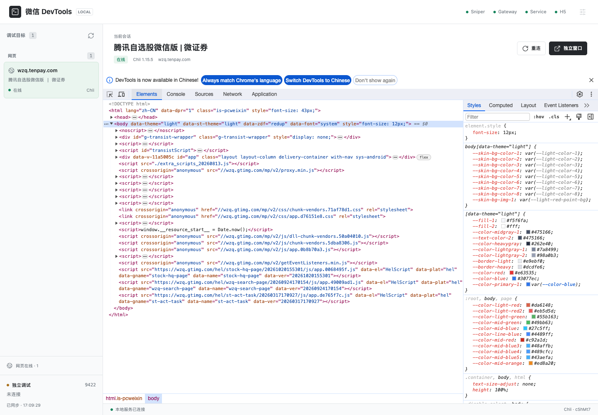

# WeChatOpenDevTools-Python · Mac ARM

面向 macOS Apple Silicon 的微信小程序与内置网页调试工具。微信 4.x 使用同一个本地后台，集中查看小程序会话、公众号文章和 H5 页面。

**统一入口：[http://127.0.0.1:8777/](http://127.0.0.1:8777/)**

[快速开始](#快速开始) · [功能与边界](#功能与边界) · [版本支持](#版本支持) · [常见问题](#常见问题) · [开源致谢](#开源致谢) · [捐助支持](#捐助支持) · [免责声明](#免责声明)



## 功能与边界

| 能力 | 小程序 · 微信 4.x | 内置网页 / 公众号文章 |
| --- | --- | --- |
| 目标列表、连接状态 | 8777 后台 | 同一后台的「网页」分组 |
| Console / JavaScript 表达式 | 支持 | 支持 |
| Network | 请求、响应、调用栈及捕获导出 | 注入后的 XHR / fetch、状态码及响应体 |
| Elements / CSS | Chrome DevTools | 后台内嵌 Chii DevTools，可查看和修改 |
| Storage | wx Storage 快照 | 网页存储未单独验收，不等同于 wx Storage |
| 源码 / 原生断点 | 依赖小程序调试通道及目标状态 | **不支持原生 V8 断点、暂停和单步** |
| 独立调试窗口 | 后台打开 Chrome DevTools | 后台点击「独立窗口」 |
| 刷新 / 重连 | 依赖通道状态；必要时重开目标小程序 | 自动发现、刷新后重新注入及重连 |

网页使用 JavaScript 实现部分调试协议的 Chii，并非原生 Chrome CDP。它不能补录注入前的请求，也不提供完整浏览器网络栈。Sources 标签可见不代表原生断点可用。严格 CSP、跨进程 iframe 和其他微信版本尚未验证。

## 版本支持

| 系统 / 微信版本 | 支持情况 |
| --- | --- |
| macOS ARM64，微信 **4.1.13.98** / WeChatAppEx **2.5.6.25561**（`f2641d62`） | 小程序流程已实现；真实公众号文章和 H5 网页已验证 |
| macOS ARM64，微信 3.8.x：`13080712`、`13080812`、`13080813`、`13080911`、`13080a11` | 保留历史地址补丁注入流程；不启动 8777 后台 |
| Intel Mac、Windows、其他微信版本 | 本仓库未验证；Windows 可参考下方致谢中的项目 |

网页注入会检查 ARM64 Framework 的 SHA-256 和函数特征。不匹配时拒绝套用旧地址。微信升级后需要重新适配配置，不能仅修改版本号。

## 快速开始

### 1. 安装依赖

需要 Python 3.9+、Node.js 18+、已安装并登录的 Mac ARM 微信。小程序、网页和后台共用一个 Python 环境，全部 Python 依赖集中在 `requirements.txt`。

```bash
git clone https://github.com/Spanky96/WeChatOpenDevTools-Python-arm.git
cd WeChatOpenDevTools-Python-arm

python3 -m venv .venv
.venv/bin/python -m pip install -r requirements.txt
npm ci --ignore-scripts
```

### 2. 启动

```bash
open -a WeChat
.venv/bin/python main.py
```

浏览器访问 **http://127.0.0.1:8777/**。

1. 在微信中打开小程序、公众号文章或 H5 页面。
2. 在左侧目标列表选择对应会话。网页会直接在后台中显示 DevTools。
3. 在 Elements、Console、Network 中检查目标；需要更多空间时打开独立窗口。

网页可以先打开再启动工具，发现与重新注入间隔约 5 秒。小程序在工具或微信重启后，通常需要重新打开一次，以触发调试连接。

`main.py` 是唯一用户启动入口，4.x 同时托管小程序、网页服务和 8777 后台，不提供单独启动 H5 或后台的模式。默认使用 direct 独立通道，无需安装微信开发者工具。Ctrl+C 停止当前管理器及其托管的服务，无需重启微信。

### 启动选项

| 命令 | 用途 |
| --- | --- |
| `.venv/bin/python main.py --mode bridge` | 使用微信开发者工具的真机调试桥；需先发起真机调试 |
| `.venv/bin/python main.py --web-port 8781` | 修改内部 Chii 端口，统一后台仍使用 8777 |
| `.venv/bin/python main.py -p <pid> --version <ID>` | 指定进程执行历史 3.8.x 注入流程 |

全部 Python 子服务使用启动 `main.py` 的同一解释器。更换 Chii 端口后，需要刷新已注入的微信网页。

## 运行结构

```text
main.py ── 127.0.0.1:8777 统一后台
  ├─ 小程序：sniper → direct / bridge → session → gateway / DevTools
  └─ 网页：Frida 注入器 → Chii :8780 → 后台内嵌 DevTools
```

8777 汇总真实目标和服务状态。网页和小程序保持各自的传输通道；网页不会作为原生 CDP target 接入 9333 gateway。

版本配置统一位于 `configs/versions.json`，按微信版本标识维护历史小程序地址和网页注入配置。公开仓库仅包含运行代码、依赖锁文件、界面资源和本文档；逆向记录、实验脚本、验收工具及日志保留在本地，不随代码发布。

## 实现与验证

网页参考 Windows 项目的 Blink ExecuteScript + Chii 方案，在 Mac ARM 上单独实现入口定位、有效 frame 校验、主线程调度和注入生命周期管理。已在真实微信网页验收表达式求值、DOM 读取与临时修改恢复、Console、XHR / fetch 响应体、刷新后重新注入和客户端重连。小程序回归检查不等同于每个小程序均已真机验证。

此前长期未交付的主要原因，是过早锁定恢复私有 XwebUse / 原生 CDP 的路线，并把参数改写、WebSocket 握手、分发函数命中等局部进展当作接近完成。这些证据都不能证明真实页面已经可调试。参考现有项目后，改用直接在页面执行脚本的方案，才缩小了必须解决的问题范围；相应代价是无法提供原生 V8 断点能力。

REA 提供分析工具和取证方法，没有要求每完成一阶段就暂停。仅凭现有交接和运行记录，不能把反复中断归因于某个模型或完整提示词。可确认的问题是缺少持续的端到端验收，也没有及时比较替代路线。交付应以真实页面的可用操作、刷新重连和可重复启动为准，不能按“打通几层”估算完成度。

## 常见问题

| 症状 | 排查方式 |
| --- | --- |
| 8777 无法访问 | 确认启动的是 4.x 流程，检查终端报错及端口占用 |
| 小程序列表为空 | direct 模式重新打开目标小程序；bridge 模式检查是否已发起真机调试 |
| 网页服务未连接 | 查看后台 H5 状态提示；确认当前 Python 环境依赖、Node.js 和 `npm ci` 已完成 |
| 网页列表为空 | 确认页面在微信内部打开，等待约 5 秒；检查版本 / SHA 不匹配和 CSP 错误 |
| 网页刷新后短暂离线 | 等待自动注入与重连，也可点击后台「重连」 |
| 修改端口后旧页面无法连接 | 刷新微信中的目标网页 |
| 某小程序一直无数据 | 先关闭并重开该小程序，排除复用旧后台进程的情况 |

日志位于 `/tmp/wechat_rea/`：`managed_*.log`、`h5_chii.log`、`h5_status.json`；后台状态为 `/api/status`。这些文件可能含页面地址、控制台输出和请求内容，提交 issue 前请脱敏。调试端口只监听本机，请勿通过反向代理或端口转发公开。

## 开源致谢

本项目建立在社区分享之上，感谢以下作者和项目：

- **[@markx520](https://github.com/markx520) / [WeChat-H5-DevTools](https://github.com/markx520/WeChat-H5-DevTools)**：分享 Windows 微信网页调试实现，其文章模式中的 Blink ExecuteScript + Chii 路线，是本仓库网页功能落地的重要参考。Mac ARM 的入口、对象校验、主线程调度和生命周期管理在本仓库单独实现。参考版本为 [`da620bc`](https://github.com/markx520/WeChat-H5-DevTools/tree/da620bc8e6db755a4ae5effde6e3d59b194565a1)。
- **[Chii](https://github.com/liriliri/chii)**：提供网页端远程 DevTools，本仓库锁定 1.15.5，MIT 许可。
- **[netz888/zhong-wechat-wmpf-debugger](https://github.com/netz888/zhong-wechat-wmpf-debugger)**：提供 WMPF direct 传输的参考。
- **志远的 WeChatOpenDevTool、JaveleyQAQ、Sndav**：提供本仓库历史微信 3.8.x 流程的基础实现与贡献，保留原项目致谢。
- **[Frida](https://github.com/frida/frida)、[Lucide](https://github.com/lucide-icons/lucide)、[js-beautify](https://github.com/beautifier/js-beautify)** 及相关依赖的维护者。

第三方代码、素材和依赖分别遵循其原有许可。致谢不改变任何上游许可，也不表示上述作者为本项目提供担保或背书。

## 捐助支持

维护版本适配、排查兼容性问题需要持续投入。如果本项目对你的开发工作有帮助，欢迎自愿支持维护。捐助不是购买服务，也不附带功能、时限或兼容性承诺。


支付宝扫码支持，感谢每一位分享问题、提交修复和参与测试的使用者。

## 免责声明

本项目是社区维护的第三方开发与学习研究工具，与腾讯、微信及支付宝官方无隶属或合作关系。相关名称、商标归其权利人所有。

请仅在你拥有或已获明确授权的应用、页面与账号中使用，并遵守适用法律及平台协议。不得用于未授权访问、窃取数据、绕过支付或实施其他侵权行为。

工具按现状提供，不承诺适用于所有版本或场景。运行时注入可能导致页面异常、客户端退出或调试数据泄露；请自行评估使用环境，避免在敏感业务操作期间进行调试。

如发现安全问题、授权争议或侵权内容，请通过本仓库 issue 联系维护者；请勿公开上传账号凭据、Cookie、收款交易信息或个人数据。本说明不替代适用法律，也不排除依法不能排除的责任。
